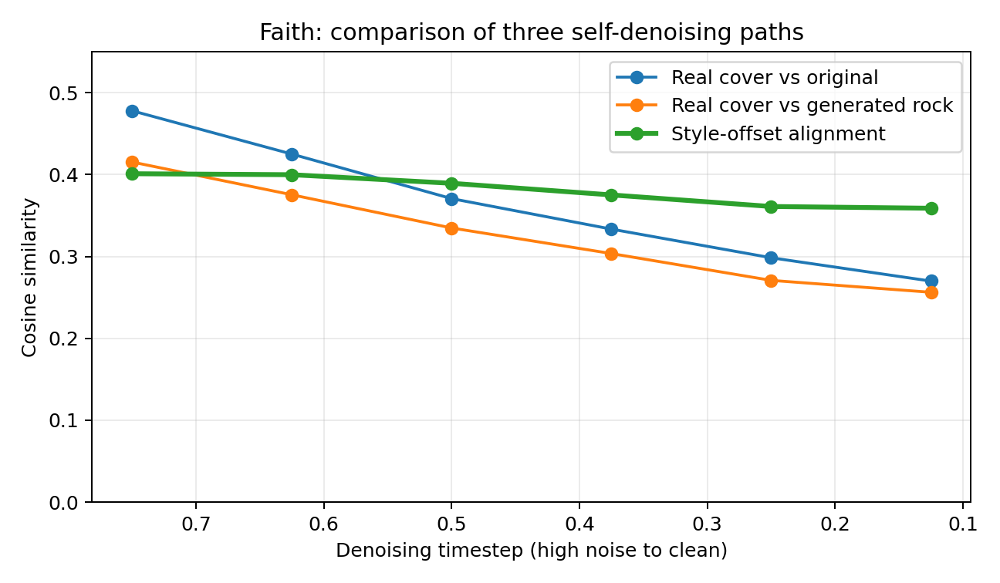

# Covers80 配对翻唱轨迹预实验

## 设置

- 数据集：Covers80（80 组翻唱关系，本地解压得到 164 个音频）
- 歌曲：`Faith`
- 原版：George Michael
- 翻唱：Limp Bizkit（摇滚/金属编曲）
- 对齐片段：20 s，半音差 `+1`，平均 chroma 距离 `0.0056`
- 模型：ACE-Step 1.5 Turbo
- 两次生成使用相同源音频、随机种子和采样参数，仅更换曲风文本。
- `cover_noise_strength=0.2`，8 步设置实际从 `t=0.75` 开始，共执行 6 个去噪步。

## 风格评分（CLAP）

| 音频 | Pop/Funk | Rock/Metal | Rock-Pop 差值 |
|---|---:|---:|---:|
| 原版片段 | 0.629 | 0.380 | -0.248 |
| 真实摇滚翻唱 | 0.219 | 0.454 | +0.235 |
| 摇滚条件生成 | 0.574 | 0.618 | +0.044 |
| 原曲风条件对照 | 0.594 | 0.396 | -0.198 |

摇滚条件使生成结果的风格判别由“更像 Pop/Funk”翻转为“更像 Rock/Metal”；同种子的原曲风对照没有发生翻转。

## 音频表征相似度（CLAP audio embedding）

| 配对 | 余弦相似度 |
|---|---:|
| 原版 ↔ 真实翻唱 | 0.543 |
| 原版 ↔ 摇滚条件生成 | 0.694 |
| 原版 ↔ 原曲风对照 | 0.801 |
| 摇滚条件生成 ↔ 真实翻唱 | 0.617 |
| 原曲风对照 ↔ 真实翻唱 | 0.456 |

摇滚条件生成相比原曲风对照更远离源音频，且更接近真实摇滚翻唱。

## 去噪轨迹与真实翻唱方向的对齐

| 条件 | 首步方向余弦 | 末步方向余弦 | 首步投影比例 | 末步投影比例 |
|---|---:|---:|---:|---:|
| 摇滚条件 | 0.349 | 0.280 | 0.298 | 0.260 |
| 原曲风对照 | 0.304 | 0.246 | 0.259 | 0.232 |

摇滚条件在所有去噪阶段都更靠近真实摇滚翻唱方向，但提升幅度较小，且对齐程度在去噪后期持续下降。

## 三条“加噪—自还原”轨迹对比

将原版、真实摇滚翻唱、模型生成的摇滚分别编码，使用同一随机种子加噪，再在各自的曲风条件下去噪还原。

直接比较绝对速度会混入大量公共去噪成分，因此以原版轨迹为基线，比较“真实翻唱 - 原版”和“生成摇滚 - 原版”两个风格偏移：

| 指标 | 首步 | 末步 | 全程均值 |
|---|---:|---:|---:|
| 风格速度方向余弦 | 0.401 | 0.359 | 0.381 |
| 预测干净结果的风格偏移余弦 | 0.288 | 0.267 | 0.272 |
| 中间状态风格偏移余弦 | 0.252 | 0.242 | 0.206 |

生成摇滚的风格速度与真实翻唱的风格速度为中等正相关，而不是无关。对齐在高噪声时最强，随去噪进行略有下降。

## 初步结论

1. 模型并非完全没有目标曲风方向，文本条件确实改变了轨迹。
2. 现有轨迹只弱对齐于真实翻唱方向，这支持继续研究路径规划。
3. 单一翻唱不是唯一正确目标，因此不能只用 latent 逐点距离判定成败，需要同时使用曲风评分和内容保持评分。

局限：当前仅有一组歌曲、一个片段，且未输入歌词，只能作为中期阶段的预实验，不能视为完整结论。
