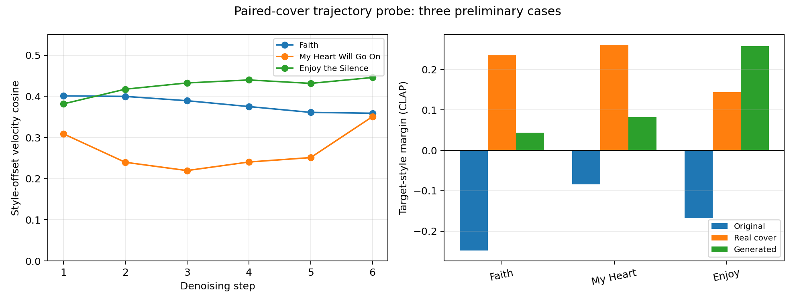

# 真实翻唱去噪轨迹预实验（3 组）

## 实验方法

对每组歌曲的三个 20 秒版本分别进行自还原：

1. 原始歌曲；
2. 真实目标曲风翻唱；
3. ACE-Step 根据原始歌曲生成的目标曲风版本。

三者使用相同噪声、随机种子、噪声强度和去噪时间步。以原曲轨迹为基线，比较真实翻唱和生成结果相对于原曲的速度偏移。

## 结果

| 歌曲 | 曲风变化 | 风格速度对齐 | 干净预测对齐 | 生成结果目标风格余量 |
|---|---|---:|---:|---:|
| Faith | Pop/Funk → Rock/Metal | 0.381 | 0.272 | +0.044 |
| My Heart Will Go On | Pop Ballad → Pop Punk | 0.268 | 0.211 | +0.083 |
| Enjoy the Silence | Synth Pop → Alternative Piano | 0.425 | 0.326 | +0.258 |
| **平均** | — | **0.358** | **0.270** | — |

三组原曲的目标风格余量均为负值，生成结果均变为正值，说明文本条件在三组数据上都推动了目标曲风转换。

## 初步发现

1. 生成曲风路径与真实翻唱路径在三组中均为正对齐，说明模型已有部分目标曲风方向。
2. 对齐强度只有中等水平，平均为 `0.358`，说明模型生成路径与真实翻唱路径仍有明显差距。
3. 曲风方向的有效时段不统一：`Faith` 逐步下降，`My Heart Will Go On` 呈 U 型，`Enjoy the Silence` 逐步上升。
4. 因此，当前证据不支持所有歌曲共用一个固定的“前期加强/后期减弱”时间表。更合理的方向是根据当前步的曲风方向对齐度，做自适应路径规划。

## 局限

- 当前仅有 3 组歌曲，属于中期阶段的预实验。
- 片段是基于 chroma 自动对齐，不是音素级人工对齐。
- 实验未输入完整歌词，不用于评价歌词保持。
- Covers80 没有可靠的曲风标签，尚缺严格的“流行原曲 → 真实爵士翻唱”开放配对。
